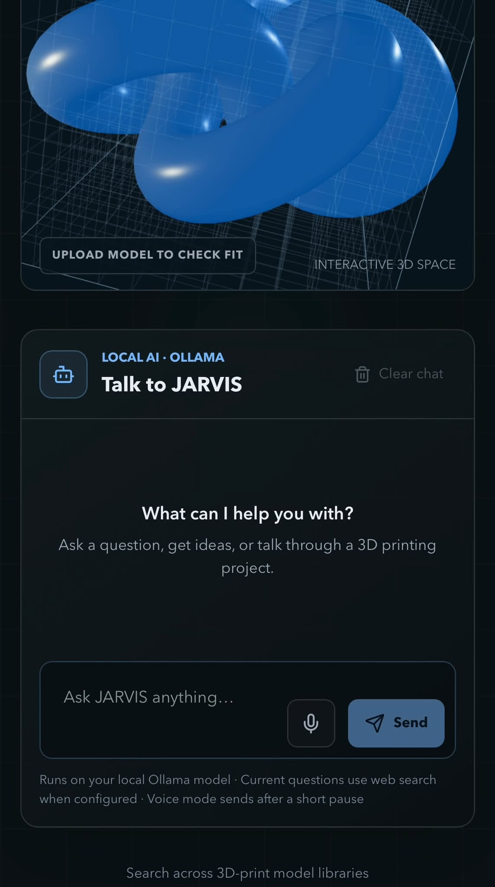
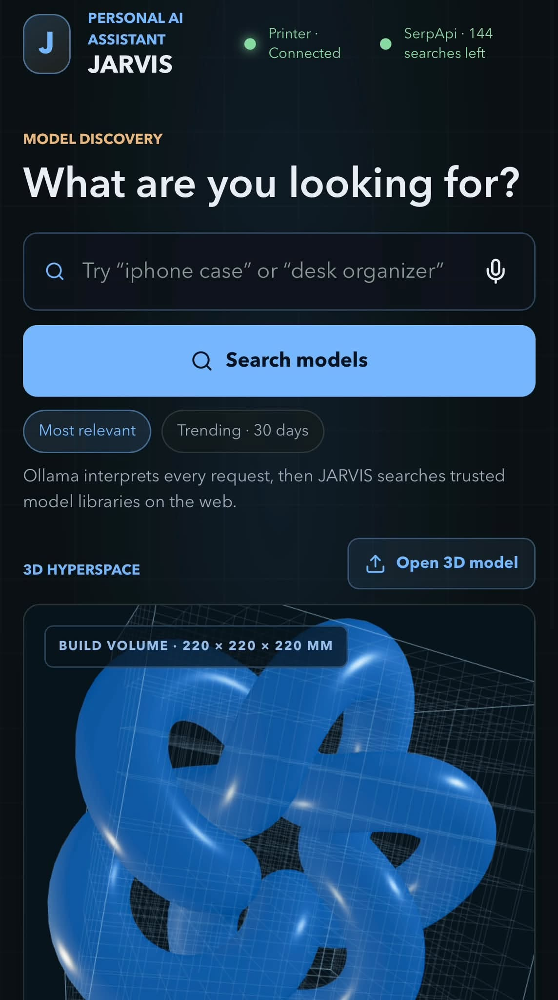

# JARVIS — AI 3D Printing Assistant

JARVIS is a holographic, desktop-first AI assistant built in React + TypeScript. The app includes a futuristic interface, voice-enabled search flow, model catalog, 3D viewer, and local persistence.

## Screenshots





## Stack

- Frontend: React + TypeScript + Vite
- Styling: Tailwind CSS + custom holographic theme
- 3D: React Three Fiber + Drei
- State and persistence: React state + localStorage
- Voice: browser speech recognition and speech synthesis where supported

## Prerequisites

Before running JARVIS locally, make sure you have:

- Node.js 20+ and npm installed
- Ollama installed and running locally
- A model downloaded in Ollama, such as `llama3.2:latest`

Install Ollama from the official download page for your OS: https://ollama.com/download, then start the service and pull a model:

```bash
ollama serve
ollama pull llama3.2:latest
```

You can verify the local endpoint is available at `http://127.0.0.1:11434`.

## Running locally

```bash
npm install
npm run dev
```

Then open the local Vite URL in the browser.

## Build and validation

```bash
npm run build
npm run lint
```

## Environment variables

Copy `.env.example` to `.env.local`. Set `SERPAPI_API_KEY` for live web and model searches; Ollama settings can be changed if your local server or model differs from the defaults.

```bash
cp .env.example .env.local
```

Example values:

```env
SERPAPI_API_KEY=
OLLAMA_BASE_URL=http://127.0.0.1:11434
OLLAMA_MODEL=llama3.2:latest
PRINTER_IP=192.168.1.100
```

## Integration limitations and verified status

- Voice recognition is implemented through the browser’s native speech API when available. Chrome and Edge generally support it; Safari may differ by version.
- Printer status uses a server-side system ping to `PRINTER_IP` (default `192.168.1.100`, a placeholder) and refreshes every 15 seconds. “Connected” means the IP responded to ping, not that the printer is ready or actively printing; some networks or printer settings may block ping. Configure `PRINTER_IP` in `.env.local`. This endpoint is provided by the Vite development server and needs an equivalent server-side implementation in production.
- The Settings panel lets users change the displayed JARVIS name, SerpApi key, local Ollama URL/port, and printer IP. These preferences are stored in browser local storage; the SerpApi key is masked by default but is not encrypted by local storage. The key is sent only to the local JARVIS server for requests. Leave service settings empty to use `.env.local`. The app's own port remains controlled by `vite.config.ts` and requires a restart to change.
- The header displays remaining SerpApi searches using SerpApi's free Account API and refreshes every five minutes. This is the account's remaining search allowance/credits, not Ollama usage. `SERPAPI_API_KEY` remains server-side; the browser only receives the balance fields. Production deployments need an equivalent server-side `/api/serpapi/account` endpoint.
- General conversation uses the local Ollama server through the server-side `/api/assistant/chat` route. For questions requiring current information (such as business hours, current prices, or weather), Ollama identifies a search query and JARVIS retrieves live web results with SerpApi; answers include source links and must disclose when results do not verify a fact. For nearby/store-hours/weather questions, JARVIS requests browser location permission and searches around the device's coordinates; if permission is denied, provide a city or ZIP code in the question. Coordinates are sent only to the local JARVIS server for that live search and are not stored. Configure both Ollama and `SERPAPI_API_KEY` in `.env.local`. Ollama itself does not directly browse the internet. Chat messages and retrieved web content are sent to your configured local Ollama model; the provider key stays server-side. The chat microphone starts a continuous voice conversation using browser speech recognition. JARVIS sends each turn to local Ollama after about 1.4 seconds of silence, reads the reply aloud with browser speech synthesis, then resumes listening until you stop the voice session. Chrome or Edge is recommended; microphone permission and a running Ollama server are required.
- Model search uses SerpApi's Google Search API, restricted to Printables, Thingiverse, MakerWorld, Thangs, MyMiniFactory, and Cults3D; unrelated sites and search aggregators are excluded. Ollama automatically interprets a natural-language model request before JARVIS searches those libraries on the web. This requires both a running local Ollama model and `SERPAPI_API_KEY`. “Most relevant” ranks matching titles and descriptions first. “Trending · 30 days” limits Google results to pages indexed in the past month; it is a recency proxy, not a platform download/popularity metric. Search recommendations are based on the user's last 20 searches, ranked by frequency and recency, and stored only in browser local storage. For missing thumbnails, JARVIS searches images only within those approved 3D-model sites and matches preview titles to the search result; it does not use general image sites. Results without a relevant source image display a placeholder. Configure `SERPAPI_API_KEY` in `.env.local` (without a `VITE_` prefix) and restart the Vite dev server. The key stays server-side; search listings render in JARVIS, while opening a model takes you to its source page. Results depend on the search provider's index and account limits.
- In chat, Ollama detects requests to find printable 3D models from the current conversation (including follow-ups) and automatically searches the same trusted model libraries. Explicit requests such as “find me a [thing] I can print” and “find a 3D printable [thing]” always trigger a model search, even if Ollama's classifier is unavailable. Up to three matches appear beneath JARVIS's reply, preferring results with source thumbnails; results without a relevant thumbnail use the generated preview placeholder. This uses the same Ollama and SerpApi configuration as model discovery.
- Search results whose direct URL ends in `.stl` or `.3mf` include a download action. Ordinary source pages do not: source pages are not scraped for download links. Download from the source and use the local upload control to preview a model.
- The 3D viewer accepts files via the system file picker and previews STL, OBJ, 3MF, GLB, GLTF, FBX, DAE, PLY, AMF, 3DS, WRL/VRML, G-code, VTK, PCD, VOX, USD, and USDZ formats when they contain displayable geometry. Unsupported proprietary CAD formats (such as STEP) need conversion to a supported mesh format first. The viewer displays a 220 × 220 × 220 mm build-volume grid and checks uploaded model bounds against it, assuming source dimensions are in millimeters. STL and OBJ files do not declare units, so verify the file units if the fit result seems incorrect.
- Model search currently runs through Vite's development-server middleware. A production deployment needs an equivalent server-side `/api/model-search` endpoint; do not expose the provider key in browser code.

## Essential workflow

1. Open JARVIS and use the text or voice prompt.
2. Search from the model discovery panel.
3. Inspect a model and review compatibility.
4. Save a model to the library.

## Privacy and persistence

Application preferences and saved library records are stored locally in the browser. This is a practical persistence layer for the prototype and can be upgraded to IndexedDB for larger file metadata later.
